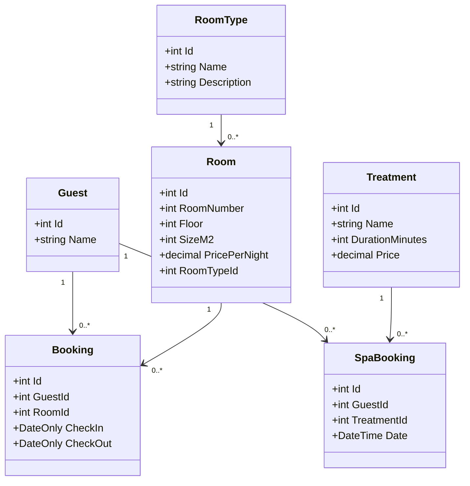

# Models

# Hotel Grandioso — Inlämning 1

**Namn:** Raman Tajerian

Ett konsolprogram för bokning av hotellrum och spabehandlingar. Det går inte att dubbelboka ett rum.

## Så kör du projektet

1. Forka repot på GitHub och klona din fork
2. Öppna `HotelGrandioso.slnx` i Visual Studio (eller öppna mappen i VS Code)
3. Tryck **F5** för att starta

Via terminalen:

```bash
dotnet run --project HotelGrandioso
```

## Databas

- Databas: SQLite (filen `hotel.db` skapas automatiskt i mappen du kör från)
- Migrationer ligger i `HotelGrandioso/Migrations`. Programmet kör `Migrate()` vid start, så databasen skapas av sig själv första gången. Så här skapar och kör du migrationer manuellt:

```bash
dotnet tool install --global dotnet-ef
dotnet ef migrations add InitialCreate --project HotelGrandioso
dotnet ef database update --project HotelGrandioso
```

Rum, rumstyper och spabehandlingar läggs in som startdata (`HasData`) i `HotelContext`.

## UML-klassdiagram



## GDPR

Hotellchefens önskelista för `Guest` innehöll namn, hårfärg, längd och religion. Jag utgår från dataminimering: jag sparar bara det som har ett tydligt syfte i systemet.

|Fält|Beslut|Motivering|
|---|---|---|
|`Name`|Behålls|Hotellet måste veta vem som har bokat.|
|`HairColor`|Tas bort|Ingen funktion i systemet behöver den, så det finns inget syfte att spara den.|
|`HeightCm`|Tas bort|Samma skäl. Den har inget med bokning av rum eller spa att göra.|
|`Religion`|Tas bort|Religion är en känslig personuppgift (GDPR artikel 9) som kräver särskilda skäl. En bokning har inget sådant skäl.|

[Lägg till egna tankar här, till exempel att färre sparade uppgifter ger mindre risk om databasen läcker.]

## Designmönster

Jag har använt **Repository-mönstret**. `HotelRepository` är den enda klassen som pratar med databasen (via `HotelContext`). Den hämtar och sparar rum, bokningar, gäster och spabehandlingar, men innehåller inga regler.

Jag valde det för att:

- reglerna (dubbelbokning, prisberäkning, validering) ligger för sig i `BookingService`
- menyn (`Menu`) inte behöver veta något om databasen
- det blir lätt att ändra en fråga eller byta databas på ett ställe

### Tillgänglighetskontrollen (LINQ)

```csharp
_db.Rooms.Where(r => !_db.Bookings.Any(b =>
    b.RoomId == r.Id && b.CheckIn < to && from < b.CheckOut))
```

Ett rum är ledigt om det inte finns någon bokning på rummet som överlappar perioden. Två perioder överlappar om varje periods start ligger före den andras slut. Jag använder `<` och inte `<=`, så att en gäst kan checka in samma dag som en annan checkar ut.

## Tekniker

- C# / .NET 10
- Entity Framework Core 10 (Code First, migrationer) med SQLite
- LINQ
- Mermaid för UML


